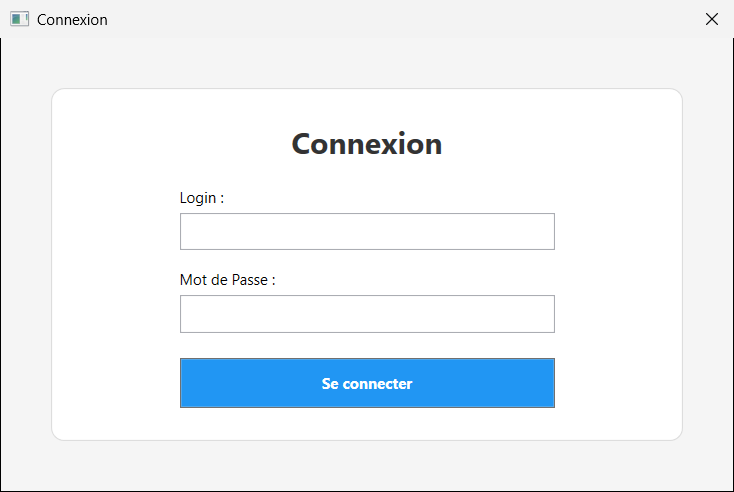
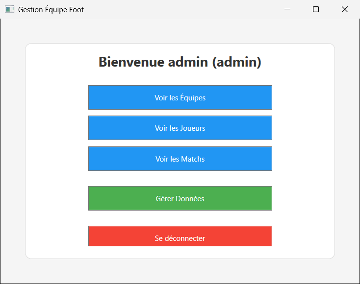
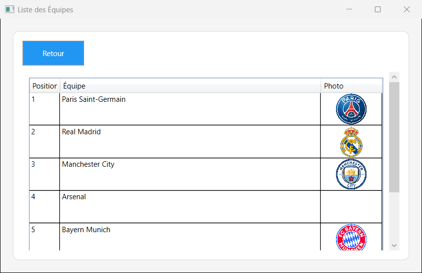
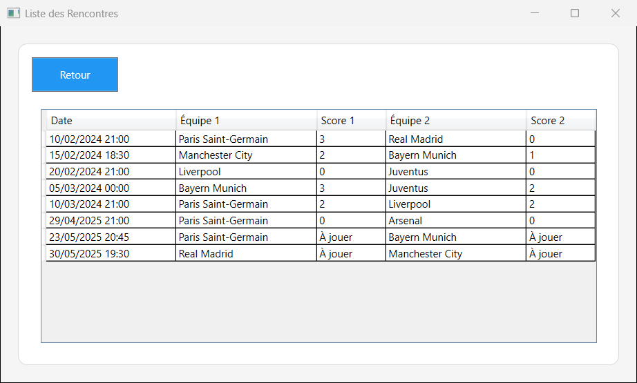
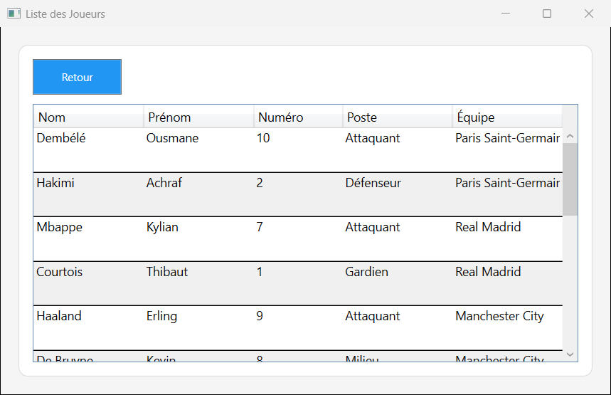
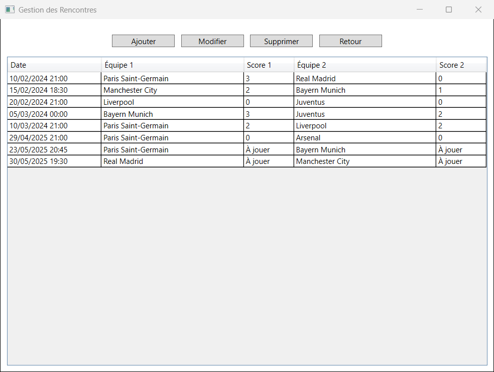

# Gestion d'un club de football

Application de bureau réalisée pendant mon **BTS SIO option SLAM** (2024–2025), épreuve E6 « client lourd ».

Elle permet de consulter les équipes (avec leur classement), les joueurs et le programme des matchs.
Un **administrateur** peut en plus ajouter, modifier et supprimer les équipes, les joueurs et les rencontres
(programmer un match, saisir le score, annuler un match). Un compte **joueur** a seulement accès à la consultation.

## Captures

| Connexion | Menu (administrateur) |
|---|---|
|  |  |

| Équipes | Matchs |
|---|---|
|  |  |

| Joueurs | Gestion des rencontres (admin) |
|---|---|
|  |  |

## Technologies

C#, WPF (.NET Framework 4.7.2), architecture MVVM (modèles, vues, view-models), MySQL avec le connecteur
`MySql.Data` (requêtes paramétrées). Mots de passe stockés hachés (PBKDF2-SHA256).

## Installation

Prérequis : Windows, Visual Studio 2022 (charge de travail « Développement .NET Desktop »), MySQL 8.

1. Créer la base avec les données d'exemple :
   ```bash
   mysql -u root -p < database/club_foot.sql
   ```
   (ou onglet **Importer** de phpMyAdmin). Le script crée la base `club_foot`.
2. Copier `GestionEquipeFoot/db.config.example` en `GestionEquipeFoot/db.config` et y mettre le mot de passe MySQL.
3. Ouvrir `GestionEquipeFoot.sln` dans Visual Studio, puis lancer avec **F5**. Les paquets NuGet sont
   restaurés automatiquement.

## Comptes de démonstration

Mot de passe pour tous : `demo1234`

| Identifiant | Rôle |
|---|---|
| `admin` | Administrateur (consultation + gestion) |
| `kmbappe` | Joueur (consultation) |

Les clubs, joueurs et logos servent uniquement d'exemples pour ce projet scolaire.

## Auteur

Mohamed FALL — [portfolio](https://mohafall.github.io) · [GitHub](https://github.com/MohaFall)
